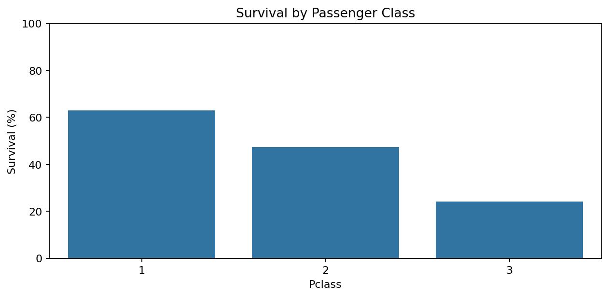
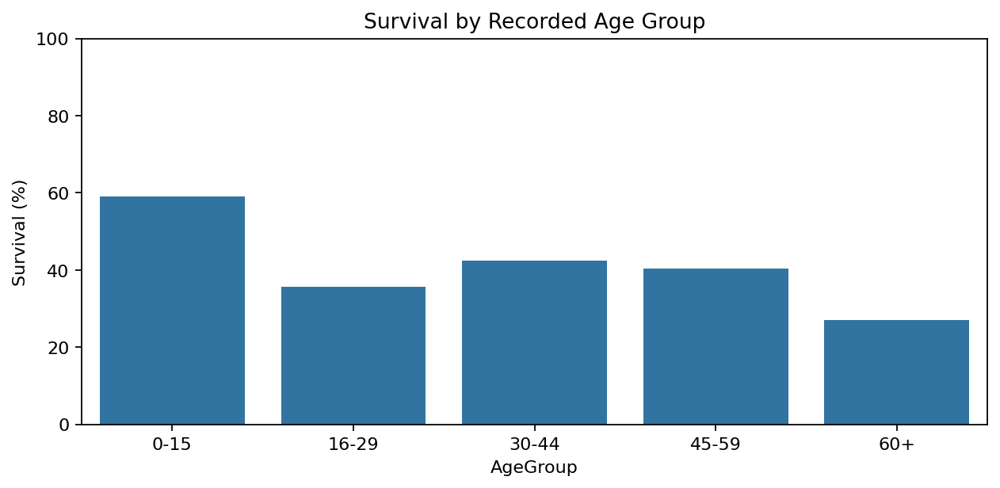
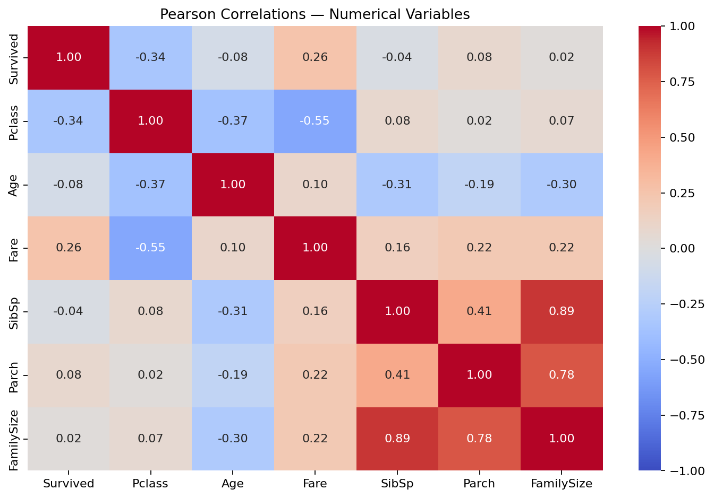

<p align="center">
  
</p>

<h1 align="center">Titanic · Passenger Survival Analysis</h1>

<p align="center">
  Exploring the passenger characteristics behind survival patterns.<br>
  <strong>Data quality · Exploratory analysis · Evidence-based storytelling</strong>
</p>

<p align="center">
  
  
  
  
  
</p>

<p align="center">
  <a href="notebooks/titanic_analysis.ipynb"><strong>Explore the notebook</strong></a> ·
  <a href="docs/PROJECT_REPORT.md">Read the report</a> ·
  <a href="data/processed/titanic_prepared.csv">Prepared dataset</a> ·
  <a href="#reproduce-the-analysis">Run locally</a>
</p>

---

## Project overview

Survival on the Titanic varied sharply across passenger groups. This project explores those differences through **30 analytical questions**, moving from data understanding and quality checks to preparation, visual exploration and interpretation.

The analysis focuses on recorded sex, passenger class, age, fare, relatives aboard, embarkation port, cabin documentation and shared tickets. Each row represents **one passenger**. Repeated tickets are valid travel-group information, not duplicate passenger records.

The goal is to explain what the data shows while keeping missing values, subgroup sizes and overlapping relationships visible.

| Passenger records | Survivors | Overall survival | Analytical questions |
|:---:|:---:|:---:|:---:|
| **891** | **342** | **38.38%** | **30** |

## Questions explored

- How does survival differ by recorded sex and passenger class?
- Do those differences remain visible when sex and class are examined together?
- How do survival rates vary across recorded ages and family sizes?
- What do fare, embarkation port, cabin availability and shared tickets reveal?
- Which comparisons are affected by missingness, small groups or class composition?

## Results at a glance

| Comparison | Observed survival | What it tells us |
|---|---|---|
| Recorded sex | Female **74.20%** · Male **18.89%** | A large difference between the recorded groups |
| Passenger class | First **62.96%** · Second **47.28%** · Third **24.24%** | Survival decreases across the three class categories |
| Sex and class together | First-class females **96.81%** · Third-class males **13.54%** | Combined groups reveal sharper contrasts |
| Known-age passengers | Under 16 **59.04%** · Adults **38.19%** | Children have higher observed survival; 177 unknown ages are excluded |
| Recorded relatives | With family **50.56%** · Alone **30.35%** | Recorded family status is associated with survival |
| Fare quartiles | Highest **58.11%** · Lowest **19.73%** | The fare gradient overlaps with passenger class |

> These are descriptive associations within the 891-passenger sample. They do not establish causation or guarantee an individual passenger's outcome.

## Visual exploration

### Sex and class: looking beyond a single comparison


Females have higher observed survival within every passenger class. Examining both dimensions together adds context that an overall percentage cannot provide.

### Class and age: different perspectives on survival

| Passenger class | Recorded age groups |
|---|---|
|  |  |

Age comparisons use **714 passengers with recorded ages**. Age intervals are defined explicitly in the notebook; the oldest group contains only 26 passengers.

### Correlation: useful context, with limits



Fare and passenger class are related, so their associations with survival should not be interpreted as separate causal effects. Age correlations use available pairs, and text categories such as Sex are excluded from this numerical matrix.

[Browse all 16 figures](outputs/figures/) · [Browse the 21 exported evidence tables](outputs/tables/)

## Data quality and preparation

| Issue | Evidence | Decision |
|---|---|---|
| Missing age | 177 records · **19.87%** | Keep missing values; use a known-age subset for age comparisons |
| Missing cabin | 687 records · **77.10%** | Preserve missing text and create an availability indicator |
| Missing embarkation port | 2 records · **0.22%** | Use an explicit `Unknown` reporting category |
| Extreme fares and family counts | Reviewed with IQR flags and passenger context | Retain plausible records rather than removing them automatically |
| Repeated tickets | Multiple passengers can share a ticket | Count group size with a validated many-to-one merge |
| Passenger-level consistency | Row count, keys, survival totals and source measurements checked | Keep all **891 passengers** and preserve the raw input |

Preparation adds readable labels, family size, age bands, fare quartiles, cabin availability, ticket-group size and extracted titles. It does **not** invent missing ages or convert unknown cabin information into “no cabin.”

[Full field dictionary](docs/DATA_DICTIONARY.md) · [Review and decision log](docs/REVIEW_AND_DECISIONS.md)

## Project structure

| Path | Contents |
|---|---|
| [notebooks/](notebooks/) | Executed notebook with 30 questions, charts and interpretations |
| [data/raw/](data/raw/) | Unchanged reference input CSV |
| [data/processed/](data/processed/) | Prepared passenger-level dataset |
| [outputs/figures/](outputs/figures/) | 16 exported analysis figures |
| [outputs/tables/](outputs/tables/) | 21 CSV tables supporting the findings |
| [scripts/run_analysis.py](scripts/run_analysis.py) | Sequential execution and output generation |
| [docs/](docs/) | Report, provenance, dictionary, decisions and project guide |
| [assets/](assets/) | Illustrative cover and asset attribution |
| [archive/](archive/) | Original workshop notebook preserved for traceability |

## Reproduce the analysis

**Requirements:** Python 3.11+ and the packages listed in `requirements.txt`. The tested package versions are pinned.

From the project root:

```bash
python -m venv .venv
```

Activate the environment:

```powershell
# Windows PowerShell
.venv\Scripts\Activate.ps1
```

```bash
# macOS / Linux
source .venv/bin/activate
```

Install dependencies and run:

```bash
python -m pip install -r requirements.txt
python scripts/run_analysis.py
```

The script executes the notebook's **72 code cells**, refreshes the notebook outputs and regenerates the prepared dataset, figures and tables. It reads the bundled local input without downloading data.

To work interactively, install JupyterLab separately:

```bash
python -m pip install jupyterlab
jupyter lab
```

Open `notebooks/titanic_analysis.ipynb` and run all cells from a fresh kernel. [Execution checks](docs/EXECUTION.md) document what was verified.

## Source and limitations

The source context is the [Kaggle Titanic competition](https://www.kaggle.com/competitions/titanic/data). This package uses an attributed [Data Science Dojo reference CSV](https://github.com/datasciencedojo/datasets/blob/master/titanic.csv). The original workshop CSV was not included in the supplied materials; matching summaries do not establish byte-level identity. The exact source URL, retrieval date and input hash are recorded in [DATA_SOURCE.md](docs/DATA_SOURCE.md).

Missingness may be systematic; rare groups have unstable rates; passengers sharing tickets or family circumstances may have related outcomes. This sample does not contain everyone aboard. Fare, class, port and cabin documentation overlap, and unmeasured rescue conditions limit interpretation.

This deliverable covers exploratory data analysis. No predictive accuracy, causal effects or separate BI dashboard are claimed. Dataset rights remain with the relevant sources; no new blanket data license is applied.

---

**Nour Reda** · [LinkedIn](https://www.linkedin.com/in/nour-reda-349b43321/) · [Email](mailto:nourreda14ou@gmail.com)

<sub>The cover is an AI-generated illustration, not an archival photograph. All analytical charts are generated directly from the documented input data. See [asset notes](assets/ATTRIBUTION.md).</sub>
