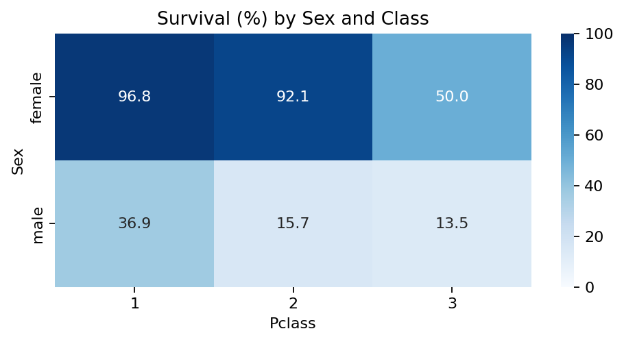

<p align="center">
  
</p>

# Titanic Survival Analysis

Analysis of **891 Titanic passengers** using Python, Pandas, NumPy, Matplotlib and Seaborn. Covers data-quality checks, preparation, visual exploration and 30 questions about survival.

[Open the notebook](titanic_analysis.ipynb) · [Prepared dataset](data/titanic_prepared.csv)

## Key findings

| Comparison | Survival rate |
|---|---|
| Overall | **38.38%** — 342 survivors |
| Female / Male | **74.20% / 18.89%** |
| First / Second / Third class | **62.96% / 47.28% / 24.24%** |



Missing ages and cabins are preserved, missing ports are labelled Unknown, and plausible outliers are retained. Results describe associations in this sample.

## Run

With Python 3.11+, run from the project folder:

```bash
python -m pip install -r requirements.txt
python -m pip install jupyterlab
python -m jupyterlab
```

Open `titanic_analysis.ipynb` and run all cells. The final cell saves `data/titanic_prepared.csv`; the source CSV remains unchanged.

## Data source

[Kaggle Titanic](https://www.kaggle.com/competitions/titanic/data), using the [Data Science Dojo reference CSV](https://github.com/datasciencedojo/datasets/blob/master/titanic.csv), retrieved 21 October 2026. The original workshop CSV was not supplied; execution uses this reference copy, whose summary statistics match the workshop. Exact identity with the original is unverified. Source terms apply.

**Nour Reda** · [LinkedIn](https://www.linkedin.com/in/nour-reda-349b43321/)

<sub>Cover: user-supplied Titanic (1997) image; rights remain with their respective holders.</sub>
